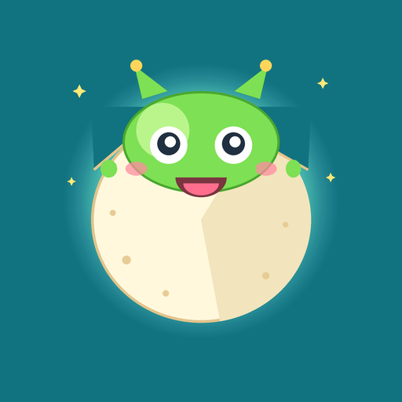
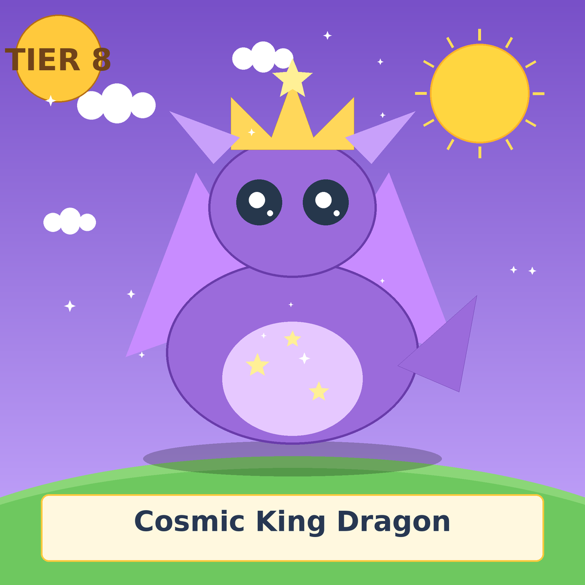

<div align="center">



# 🐉 MONSTER MERGE

### Hatch. Merge. Evolve. Become legendary!

[](https://godotengine.org)
[](https://github.com/Gass-OS/Monster-Merge/actions)
[](https://github.com/Gass-OS/Monster-Merge)
[](https://github.com/Gass-OS/Monster-Merge/actions)

**A bright little world filled with magical creatures, floating clouds and big discoveries. Start with a mysterious egg, combine matching monsters, and grow your collection from a tiny hatchling into the mighty Cosmic King Dragon.**

</div>

---

## ✨ The adventure

- 🥚 **Hatch new friends** — tap the Spawn Egg button, or let the automatic spawner bring a new Tier 1 creature every few seconds
- 🧬 **Merge to evolve** — drag matching monsters together, or tap two matching creatures, to create the next evolution
- 🪙 **Build your coin stash** — every merge pays a coin bonus, while evolved monsters earn passive income every second
- 🏆 **Complete your collection** — 8 hand-crafted monster tiers, with showcase artwork and alternate poses in the gallery
- 🎁 **Come back for rewards** — daily gifts and streaks, rotating missions, achievements and surprise gift boxes on the board
- 🎡 **Take a fun detour** — Lucky Spin, Monster Slots and Mystery Egg in the casino corner (in-game coins only)
- 👹 **Boss Rush** — every 25 merges a boss appears: beat the clock with your monsters to win big rewards
- 🎨 **Make the world yours** — Sunny, Sunset, Starry Night and Candy Land themes
- 💾 **Keep your progress** — coins, discoveries, settings and board state save locally

## 🐲 Meet the evolution family

| Tier | Creature | |
|---:|---|---|
| 1 | **Blue Spotted Egg** | The beginning of a mystery |
| 2 | **Cute Green Slime** | A squishy new companion |
| 3 | **Baby Green Dino** | A tiny prehistoric pal |
| 4 | **Winged Flame Wyrm** | A fiery sky guardian |
| 5 | **Golden Phoenix** | A radiant rebirth |
| 6 | **Crystal Unicorn** | A sparkling mythical wonder |
| 7 | **Robo-Rex** | A powerful mechanical beast |
| 8 | **Cosmic King Dragon** | The ultimate legendary evolution |



## 🎮 How to play

1. Tap **SPAWN EGG** to hatch a monster — new eggs also arrive automatically while you play.
2. Drag one monster onto another of the **same tier**, or tap the first and then the second (matching tiers glow).
3. Watch them merge into the next evolution and collect your coin bonus.
4. Higher-tier monsters earn more passive coins.
5. Complete missions, claim daily gifts and unlock every creature in the gallery.

The board has 16 spaces, so plan your merges and make room for the next hatch!

## 🌈 A living little world

A colourful animated sky with drifting clouds, a sun or smiling moon, butterflies, sparkles and a hot-air balloon. Monsters bob, blink and wiggle. Merges are celebrated with glow bursts, flying coins, sound effects and unlock confetti — with a procedural soundtrack and playful voice blips.

The main menu, game board, gallery, settings and reward panels are built for a portrait mobile screen (720×1280). Android back opens the pause menu (never quits the game directly); the settings panel controls music, sound, voices, vibration and themes.

---

## 📦 Get the game

Every push to `main` builds an APK with GitHub Actions — download **`Monster-Merge-Android-APK`** from the latest successful run's artifacts ([Actions page](https://github.com/Gass-OS/Monster-Merge/actions)). Current APK is about **37 MB**.

> The game is not on Google Play yet — the CI artifact is the way to install it for now.

---

## 🛠️ Project details

| | |
|:---|---|
| **Engine** | Godot 4.4.1, GL Compatibility renderer |
| **Language** | GDScript |
| **Genre** | Casual merge, creature collection, idle progression |
| **Orientation** | Portrait 720×1280 |
| **Android** | arm64-v8a — package `com.gassos.monstermerge` |
| **Save data** | `user://monster_merge_save.json` |
| **Art & music** | Gallery showcase art in `assets/gallery/` (PNG), procedural soundtrack in `assets/music/` (OGG) |

```bash
git clone https://github.com/Gass-OS/Monster-Merge.git
cd Monster-Merge
# Open project.godot with Godot 4.4.1 — project files live at the repo root
```

> **Build note:** Android export uses the prebuilt template (`use_gradle_build=false`) with ETC2/ASTC texture import enabled — that combination is what makes CI export work. Don't re-enable Gradle.

### Project layout

```
├── scenes/Main.tscn     # the whole game — menu, board, casino, gallery
├── scripts/             # grid, monsters, casino, boss rush, missions, themes, audio
├── assets/gallery/      # showcase + alternate art for all 8 tiers
├── assets/music/        # procedural soundtrack tracks
└── icon.png             # slime hatching from an egg
```

---

## 📜 Version history

| Version | Highlights |
|:---:|---|
| **1.3.2** | Casino panels centred on screen, unlock art centred |
| 1.3.1 | Settings / back-button fix — panels really close, back opens pause |
| 1.3.0 | Deep Systems — settings, pause, missions, gifts, Boss Rush, themes, casino |
| 1.2.0 | Bright cartoon look, main menu, tap-to-merge, casino, soundtrack |
| 1.1.0 | Graphics upgrade, merge juice, procedural sounds, unlock popups |

---

<div align="center">

**Made with Godot 💚**

*Developed by Wael Gharsalli — a Gass-OS game.*

</div>
